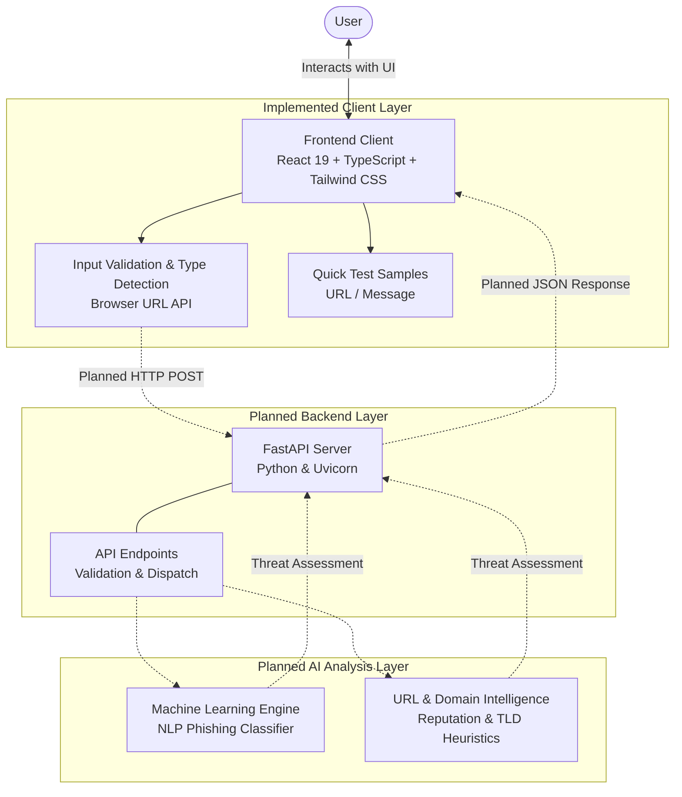
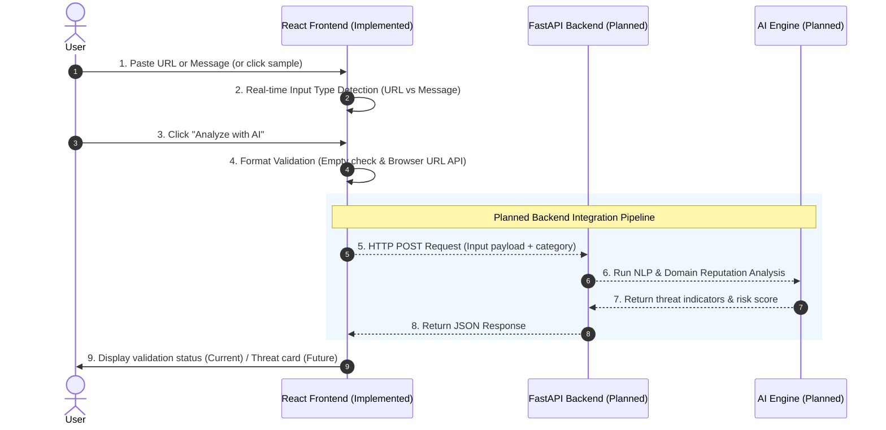

# SIFTRIX — Technical Documentation
### AI-Powered Cybersecurity Platform for Phishing & URL Threat Detection

---

## 1. Project Overview

### What SIFTRIX Does
**SIFTRIX** is an AI-powered cybersecurity platform designed to protect individuals and organizations by detecting phishing messages, suspicious URLs, social engineering attempts, and online digital threats. The platform provides a simple, accessible interface where users can paste suspicious content to verify its safety before clicking links or responding to messages.

### Main Purpose & Target Users
* **Purpose**: Phishing and malicious links are the leading entry points for data breaches, credential theft, and ransomware. SIFTRIX aims to demystify threat detection by providing non-technical users with clear, actionable threat assessments.
* **Target Users**:
  * **Everyday Internet Users**: Individuals seeking to verify unsolicited SMS alerts, suspicious emails, or unfamiliar links before interacting with them.
  * **Small Business Employees**: Staff members needing a rapid first line of defense to screen suspicious communications before escalating to IT security teams.
  * **Cybersecurity Students & Evaluators**: Capstone evaluators assessing modern AI-driven threat mitigation architectures and user-centered security tools.

### Current Frontend Technology Stack
* **UI Library**: React 19 (`^19.3.1`)
* **Build Tool & Development Server**: Vite (`^8.3.6`)
* **Programming Language**: TypeScript (`~6.0.3`) for strict static typing
* **Styling Framework**: Tailwind CSS v4 (`^4.3.5`) with `@tailwindcss/vite`
* **Validation Standard**: Native Browser WHATWG `URL` API
* **Linting & Code Quality**: ESLint 9 (`^10.14.0`) with React Hooks and TypeScript plugins

---

## 2. System Architecture

### Architectural Component Breakdown



### Component Roles & Status

| Component | Technology | Role | Status |
|---|---|---|---|
| **Frontend Client** | React 19, TypeScript, Tailwind CSS v4 | Provides the responsive user interface, handles input capture, detects input type (URL vs. Message), validates formats, and manages user navigation. | **Implemented & Verified** |
| **Input Validator** | Browser WHATWG `URL` API | Verifies URL structure, excludes non-URL strings (such as email addresses, single-word sentences, and common file names), and surfaces instant validation errors. | **Implemented & Verified** |
| **Backend API Server** | Python, FastAPI, Uvicorn | Receives scan requests from the frontend client, coordinates input preprocessing, and routes data to detection engines. | **Planned / Pending Implementation** *(Referenced in `backend/README.md`)* |
| **AI Threat Engine** | Python ML / NLP Libraries | Analyzes message text for psychological urgency and credential harvesting signatures; evaluates domain reputation, TLD risk, and typo-squatting for URLs. | **Planned / Pending Implementation** |

---

## 3. Threat Detection Flow

The end-to-end detection lifecycle consists of five stages, clearly delineating what currently occurs in the frontend client from what is planned for backend integration:



### Stage Details:
1. **User Input Entry**: The user pastes a suspicious message or URL into the central textarea, or clicks one of the Quick Test Sample buttons (`Sample URL`, `Sample Message`).
2. **Real-Time Input Type Detection**: The frontend dynamically classifies the input as either a **URL** or a **Message**:
   * Inspects for web prefixes (`http://`, `https://`, `www.`).
   * Explicitly disqualifies standalone email addresses (containing `@`) and punctuated words (such as `"Hello."` or `"Done."`).
   * Disqualifies standalone file extensions (e.g., `report.pdf`, `data.csv`).
   * Verifies valid domain structure and TLD format for bare URLs (e.g., `example.com`).
   * Displays a real-time badge: `Detected Type: URL` or `Detected Type: Message`.
3. **Client-Side Format Validation**: When the user clicks "Analyze with AI":
   * **Empty / Whitespace**: Rejects with `"Please enter a message or URL first."`
   * **Invalid URL**: Rejects with `"Invalid URL format. Please enter a valid URL (e.g., https://example.com)."`
   * **Valid Input**: Accepts input and logs confirmation to the browser console.
4. **Backend API Dispatch (Planned)**: The client will package the validated text and input category into an HTTP POST request sent to the FastAPI backend server.
5. **AI Threat Detection & Scoring (Planned)**: The backend will analyze the input for indicators of compromise (urgency tactics, spoofed domains, malicious redirection) and return a structured risk assessment.
6. **Result Display (Planned)**: The frontend will render the risk score, threat category, AI reasoning, and recommended user actions.

---

## 4. API Contract & Frontend Client Documentation

> [!IMPORTANT]
> **Integration Status**: The frontend is wired to the verified `POST /api/scan` backend contract (`http://localhost:8000` by default). Live end-to-end verification against a running backend server remains pending when backend connectivity is offline in the local workspace.

### Frontend API Client Structure (`frontend/src/services/`)

The frontend connects to the FastAPI backend via a modular, typed API client layer:

1. **Centralized Configuration (`src/services/config.ts`)**:
   * Reads `import.meta.env.VITE_API_BASE_URL` with a default fallback to `http://localhost:8000`.
   * Sets request timeout to 30 seconds (`TIMEOUT_MS = 30000`) to accommodate multi-agent AI analysis.
   * Configures standard JSON request headers (`application/json`).
   * Environment variable template provided in `frontend/.env.example`.

2. **Generic Reusable API Client (`src/services/apiClient.ts`)**:
   * **Envelope Pattern**: All requests return a typed `ApiResponse<T>` containing `{ data, error, status, ok }`.
   * **Timeout Controller**: Employs `AbortController` to cleanly cancel hanging requests after 30 seconds.
   * **Comprehensive Error Handling**:
     * HTTP status code translation (400, 401, 403, 404, 422, 500).
     * Extracts FastAPI string `detail` errors and 422 validation error arrays (`detail[].loc` / `detail[].msg`).
     * Catches malformed JSON payloads, network dropouts, and connection-refused errors without falling back to fake scan results.
   * **Methods**: Provides `apiGet<T>` and `apiPost<T>`.

3. **API Service Module (`src/services/api.ts`)**:
   * Defines TypeScript types matching the verified FastAPI contract (`ScanRequest`, `ScanResponse`, `BilingualSummary`, `BilingualRecommendations`, `AgentFindings`).
   * Exposes `submitScan()` targeting `POST /api/scan`, `checkBackendHealth()` targeting `GET /api/health`, and runtime validator `isValidScanResponse()`.

### Verified `POST /api/scan` Contract

* **Request Payload**:
  ```json
  {
    "target_type": "url | message | email",
    "content": "string",
    "metadata": {}
  }
  ```
* **Response Fields Rendered in [`ScanResultCard.tsx`](../frontend/src/components/ScanResultCard.tsx)**:
  * `overall_risk_score` (`0–100`), `verdict` (`safe | suspicious | malicious`), and `risk_level` (`low | medium | high | critical`)
  * Bilingual `summary` (`en` / `ur`) and `recommendations` (`en` / `ur`) with automatic RTL formatting for Urdu
  * `agent_findings` (`url_intelligence`, `message_intelligence`, `security_advisor`, `raw_metadata`) with graceful handling of partial/incomplete provider outputs

---

## 5. Current Project Status & Honest Assessment

### Completed Frontend Features (Verified)
- [x] **Responsive Landing Page**: Fully responsive across Desktop (1440px), Tablet (768px), and Mobile (375px) without horizontal scrolling or button wrapping.
- [x] **Smooth In-Page Navigation**: Working smooth scroll navigation between `#home`, `#scan`, `#features`, and `#about`.
- [x] **Real-Time Input Type Detection**: Accurate classification between URLs and normal messages (`looksLikeUrl`).
- [x] **Edge-Case URL Validation**:
  - Validates URLs with protocols (`https://google.com`, `http://example.com`).
  - Validates bare domains and `www` addresses (`www.example.com`, `example.com`).
  - Correctly excludes email addresses (`user@example.com` treated as a message).
  - Correctly excludes punctuated single words (`"Hello."`, `"Done."`).
  - Correctly excludes standalone file names (`report.pdf`).
- [x] **Quick Test Samples**: One-click demo buttons (`Sample URL`, `Sample Message`, and `Clear`) for live presentations and grading.
- [x] **Modular Component Architecture**: Clean components (`Navbar.tsx`, `Hero.tsx`, `Scanner.tsx`, `ScanResultCard.tsx`, `Features.tsx`, `About.tsx`, `Footer.tsx`) and utility module (`urlValidator.ts`).
- [x] **FastAPI Integration (`POST /api/scan`)**: Connected `Scanner.tsx` to `submitScan()` with 30s timeout, HTTP/network/incomplete-provider error handling, bilingual result rendering (`en`/`ur`), and multi-agent findings display.
- [x] **Accessibility & Metadata Standards**: Added WCAG ARIA live regions, keyboard navigation rings, `Ctrl+Enter` shortcut, live character counter, Open Graph social tags, and search engine metadata in `index.html`.
- [x] **Automated Unit Testing**: Vitest test suite (`src/utils/urlValidator.test.ts` and `src/services/api.test.ts`) verifying URL rules, payload schema, and client error handling.
- [x] **Code Quality & Build Health**: Zero errors across `tsc -b && vite build` and `eslint .`.

### Pending Tasks
- [ ] Run live end-to-end verification in the browser once the FastAPI backend is reachable at `http://localhost:8000` (with CORS configured for the Vite frontend).
- [ ] Build scan history UI consuming `GET /api/scans` and `GET /api/scans/{scan_id}` when scheduled.

### Current Limitations
1. **Live Backend Connectivity Pending**: In this local environment, `http://localhost:8000` / `http://127.0.0.1:8000` must be running and reachable for live scans; when offline, the scanner surfaces a connection error cleanly rather than showing simulated results.
2. **No Scan History UI Yet**: `GET /api/scans` and `GET /api/scans/{scan_id}` are deferred to a separate iteration.

---

*Documentation prepared for the SIFTRIX Capstone Evaluation.*
