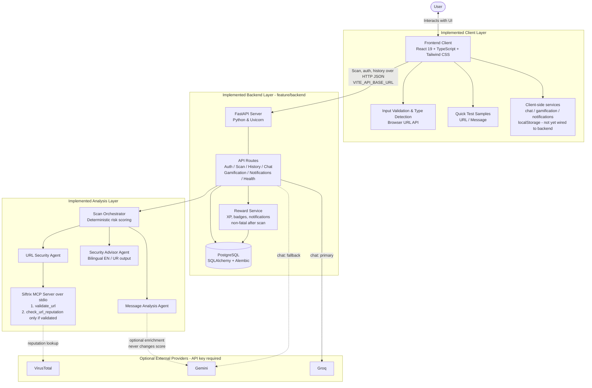
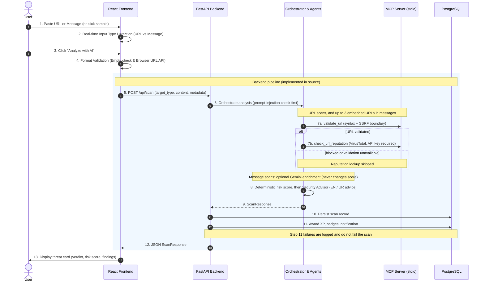

# SIFTRIX — Technical Documentation
### AI-Powered Cybersecurity Platform for Phishing & URL Threat Detection

---

## 1. Project Overview

### What SIFTRIX Does
**SIFTRIX** is an AI-powered cybersecurity platform designed to protect individuals and organizations by detecting phishing messages, suspicious URLs, social engineering attempts, and online digital threats. The platform provides a simple, accessible interface where users can paste suspicious content to verify its safety before clicking links or responding to messages.

### Main Purpose & Target Users
* **Purpose**: Phishing and malicious links are the leading entry points for data breaches, credential theft, and ransomware. SIFTRIX aims to demystify threat detection by providing non-technical users with clear, actionable threat assessments.
* **Target Users**:
  * **Everyday Internet Users**: Individuals seeking to verify unsolicited SMS alerts, suspicious emails, or unfamiliar links before interacting with them.
  * **Small Business Employees**: Staff members needing a rapid first line of defense to screen suspicious communications before escalating to IT security teams.
  * **Cybersecurity Students & Evaluators**: Capstone evaluators assessing modern AI-driven threat mitigation architectures and user-centered security tools.

### Current Frontend Technology Stack
* **UI Library**: React 19 (`^19.3.1`)
* **Build Tool & Development Server**: Vite (`^8.3.6`)
* **Programming Language**: TypeScript (`~6.0.3`) for strict static typing
* **Styling Framework**: Tailwind CSS v4 (`^4.3.5`) with `@tailwindcss/vite`
* **Validation Standard**: Native Browser WHATWG `URL` API
* **Linting & Code Quality**: ESLint 9 (`^10.14.0`) with React Hooks and TypeScript plugins

### Backend Technology Stack
> [!NOTE]
> **Source location**: The backend source code is maintained on the `feature/backend` branch. The current frontend branch only carries `backend/README.md`. The details below were verified by reading the backend source on `feature/backend`. The backend test suite (`backend/tests/`) was **not executed** during this documentation review.

* **Web Framework**: FastAPI (`fastapi>=0.115.0`) served with Uvicorn (`uvicorn[standard]`)
* **Data Validation & Settings**: Pydantic v2 and `pydantic-settings` (environment-driven configuration)
* **Database**: PostgreSQL via SQLAlchemy 2.x and `psycopg` 3, with Alembic schema migrations
* **Authentication**: JWT bearer tokens (`PyJWT`, `HS256`); passwords hashed with **scrypt** using a unique salt per password
* **MCP**: Official `mcp` Python SDK (FastMCP server and stdio client)
* **External Providers (optional, key-driven)**: Groq (primary chat), Gemini (chat fallback and optional message-analysis enrichment), VirusTotal (URL reputation)
* **HTTP Client**: `httpx` for provider calls

---

## 2. System Architecture

### Architectural Component Breakdown



### Component Roles & Status

Status labels reflect what was verified by reading source code. "Implemented in source" means the code and automated tests exist; it is **not** a claim of full end-to-end verification in production.

| Component | Technology | Role | Status |
|---|---|---|---|
| **Frontend Client** | React 19, TypeScript, Tailwind CSS v4 | Provides the responsive user interface, handles input capture, detects input type (URL vs. Message), validates formats, calls the backend for scans, authentication and scan history, and manages user navigation. | **Implemented & Verified** |
| **Input Validator** | Browser WHATWG `URL` API | Verifies URL structure, excludes non-URL strings (such as email addresses, single-word sentences, and common file names), and surfaces instant validation errors. | **Implemented & Verified** |
| **Backend API Server** | Python, FastAPI, Uvicorn | Exposes `/api/health`, `/api/auth/*`, `/api/scan*`, `/api/history*`, `/api/chat`, `/api/gamification/*`, and `/api/notifications*`, plus a root `GET /` welcome endpoint; configurable CORS; exposes the `X-Session-ID` response header. | **Implemented in source** (`feature/backend`) |
| **Database Layer** | PostgreSQL, SQLAlchemy 2.x, Alembic | Persists `users`, `scans`, `gamification_profiles`, and `notifications`; Alembic revisions `0001` (initial schema and users) and `0002` (gamification and notifications). | **Implemented in source** |
| **Authentication & Sessions** | JWT (`PyJWT`, HS256), scrypt password hashing | Register, login, and `GET /api/auth/me`; optional guest `X-Session-ID` (UUIDv4) scoping; guest scans and gamification data are migrated to the account on register/login. | **Implemented in source** |
| **Scan Orchestrator & Agents** | Python agents (`URLSecurityAgent`, `MessageAnalysisAgent`, `SecurityAdvisorAgent`) | Deterministic heuristic scoring with prompt-injection detection, at most 3 embedded URLs evaluated per message scan, bilingual (English / Urdu) summaries and recommendations from the Security Advisor. | **Implemented in source** |
| **MCP Tools** | FastMCP server (`siftrix-mcp`) over stdio | Exactly two tools: `validate_url` (syntax and SSRF boundary checks without fetching the destination) and `check_url_reputation` (VirusTotal). The URL agent only calls reputation after validation succeeds. | **Implemented in source** |
| **Chat Endpoint** | `POST /api/chat`, Groq, Gemini | Groq is the primary provider; Gemini is called only if Groq returns a fallback or empty result; if both fail, a static fallback message is returned with `is_fallback: true`. Suggested follow-ups are a fixed list, `citations` is always empty, and conversation history is supplied by the client on each request and is **not persisted** by the backend. | **Implemented in source** — key-dependent |
| **Gamification & Notifications** | PostgreSQL (`gamification_profiles`, `notifications`) | Server-side XP, levels, badges, streaks, leaderboard, and notifications persisted per user or guest session. | **Implemented in source**; **frontend integration pending** (see note below) |
| **Optional AI / Reputation Providers** | Groq, Gemini, VirusTotal | All require API keys supplied through environment variables. Gemini message enrichment (descriptions/sentiment) is optional and never overrides the deterministic score. | **Partially implemented** — key-dependent; behavior without keys falls back to deterministic findings or an `unavailable`/`is_fallback` result where the code handles it |
| **Railway Deployment** | Railway | Referenced in backend code comments, the production JWT guard, and a migration test for a pre-existing Railway schema. The frontend reads the backend URL from `VITE_API_BASE_URL`. | **Reported / referenced; not live-verified** — no Railway configuration file (e.g. `Procfile`, `railway.json`, `Dockerfile`) was found in the repository |

> [!IMPORTANT]
> **Frontend integration is pending for chat, gamification, and notifications.** The current frontend does **not** call `/api/chat`, `/api/gamification/*`, or `/api/notifications*` (no such calls were found in `frontend/src`). Frontend chat runs through the client-side `chatService`, and frontend gamification progress and notifications are stored by client-side services in browser `localStorage`. Only scans, authentication, scan history, and the health check are wired to the backend. Connecting the remaining backend endpoints to the frontend is a pending task.

---

## 3. Threat Detection Flow

The end-to-end detection lifecycle, as implemented across the frontend client and the backend source:



### Stage Details:
1. **User Input Entry**: The user pastes a suspicious message or URL into the central textarea, or clicks one of the Quick Test Sample buttons (`Sample URL`, `Sample Message`).
2. **Real-Time Input Type Detection**: The frontend dynamically classifies the input as either a **URL** or a **Message**:
   * Inspects for web prefixes (`http://`, `https://`, `www.`).
   * Explicitly disqualifies standalone email addresses (containing `@`) and punctuated words (such as `"Hello."` or `"Done."`).
   * Disqualifies standalone file extensions (e.g., `report.pdf`, `data.csv`).
   * Verifies valid domain structure and TLD format for bare URLs (e.g., `example.com`).
   * Displays a real-time badge: `Detected Type: URL` or `Detected Type: Message`.
3. **Client-Side Format Validation**: When the user clicks "Analyze with AI":
   * **Empty / Whitespace**: Rejects with `"Please enter a message or URL first."`
   * **Invalid URL**: Rejects with `"Invalid URL format. Please enter a valid URL (e.g., https://example.com)."`
   * **Valid Input**: Accepts the input and submits it to the backend via `submitScan()`.
4. **Backend API Dispatch**: The client sends the validated text and input category as an HTTP POST to `POST /api/scan` on the configured backend (`VITE_API_BASE_URL`). The request carries the `Authorization: Bearer` token when signed in, or an `X-Session-ID` guest header otherwise.
5. **Threat Analysis (Backend)**: The orchestrator first runs a prompt-injection check, then routes the content:
   * **URL scans** go to the URL agent, which calls the MCP `validate_url` tool. `check_url_reputation` (VirusTotal) is called **only after validation succeeds**, and it requires `VIRUSTOTAL_API_KEY`; a blocked URL skips the reputation lookup, and a missing key yields an `unavailable` result.
   * **Message and email scans** go to the message agent. Embedded URLs are extracted, deduplicated, prioritized, and **at most 3** are evaluated through the URL agent. Messages with no URLs never touch MCP. Gemini enrichment of descriptions/sentiment is optional (key-dependent) and never overrides the deterministic score.
6. **Scoring & Advice**: Findings are combined into a deterministic risk score. The **Security Advisor** agent then produces the bilingual (English / Urdu) summary and recommendations. See the risk classification table in section 4.
7. **Persistence, Rewards & Result Display**: The backend stores the scan record (owned by the user or guest session). It then awards XP, evaluates badges, and creates a notification; if this reward step raises an error, the error is logged and the scan response is **still returned**. The frontend renders the risk score, verdict, bilingual summary/recommendations, and agent findings in `ScanResultCard.tsx`.

---

## 4. API Contract & Frontend Client Documentation

> [!IMPORTANT]
> **Integration Status**: The frontend is wired to the backend `POST /api/scan` contract and defaults to `http://localhost:8000` unless `VITE_API_BASE_URL` is set at build time. The backend source exists on `feature/backend` and has been reported as deployed to Railway; live end-to-end behavior against the deployed service was **not** re-verified in this documentation update. Backend chat, gamification, and notifications endpoints are not yet consumed by the frontend.

### Frontend API Client Structure (`frontend/src/services/`)

The frontend connects to the FastAPI backend via a modular, typed API client layer:

1. **Centralized Configuration (`src/services/config.ts`)**:
   * Reads `import.meta.env.VITE_API_BASE_URL` with a default fallback to `http://localhost:8000`.
   * Sets request timeout to 30 seconds (`TIMEOUT_MS = 30000`) to accommodate multi-agent AI analysis.
   * Configures standard JSON request headers (`application/json`).
   * Environment variable template provided in `frontend/.env.example`.

2. **Generic Reusable API Client (`src/services/apiClient.ts`)**:
   * **Envelope Pattern**: All requests return a typed `ApiResponse<T>` containing `{ data, error, status, ok }`.
   * **Timeout Controller**: Employs `AbortController` to cleanly cancel hanging requests after 30 seconds.
   * **Comprehensive Error Handling**:
     * HTTP status code translation (400, 401, 403, 404, 422, 500).
     * Extracts FastAPI string `detail` errors and 422 validation error arrays (`detail[].loc` / `detail[].msg`).
     * Catches malformed JSON payloads, network dropouts, and connection-refused errors without falling back to fake scan results.
   * **Methods**: Provides `apiGet<T>` and `apiPost<T>`.

3. **API Service Module (`src/services/api.ts`)**:
   * Defines TypeScript types matching the FastAPI contract (`ScanRequest`, `ScanResponse`, `BilingualSummary`, `BilingualRecommendations`, `AgentFindings`).
   * Exposes `submitScan()` targeting `POST /api/scan`, `checkBackendHealth()` targeting `GET /api/health`, scan-history helpers targeting `GET /api/history` and `GET /api/history/{scan_id}`, and runtime validator `isValidScanResponse()`.

4. **Authentication Service (`src/services/authService.ts`)**:
   * Calls `POST /api/auth/register`, `POST /api/auth/login`, and `GET /api/auth/me`, forwarding the guest `X-Session-ID` so the backend can migrate guest data.

5. **Client-Side Services (not backend-connected)**:
   * Chat (`chatService`), gamification (`gamificationService`), and notifications (`notificationService`) run in the browser and persist to `localStorage`. They do not call `/api/chat`, `/api/gamification/*`, or `/api/notifications*` yet.

### Backend API Endpoints (verified from `feature/backend` source)

| Method & Path | Purpose |
|---|---|
| `GET /` | Root welcome message pointing to `/docs`. |
| `GET /api/health` | Health check returning `status: "ok"` plus `database: "connected"` or `"disconnected"` (a `SELECT 1` probe). Used by the frontend diagnostics. |
| `POST /api/auth/register` | Create an account (201) and return a JWT bearer token; duplicate email is rejected with 409 and a short password with 422. Migrates guest scans/gamification when `X-Session-ID` is supplied. |
| `POST /api/auth/login` | Authenticate and return a JWT bearer token (401 for bad credentials, 403 for inactive accounts, 400 for a malformed `X-Session-ID`). |
| `GET /api/auth/me` | Return the authenticated user's profile (Bearer token required). |
| `POST /api/scan` | Unified scan (`target_type`: `url`, `message`, or `email`). Also available: `POST /api/scan/url` and `POST /api/scan/message`. |
| `GET /api/history` | Paginated scan history for the caller (see ownership rules below). |
| `GET /api/history/{scan_id}` | Single scan record belonging to the caller (404 if not found). |
| `DELETE /api/history/{scan_id}` | Delete a scan record belonging to the caller. |
| `POST /api/chat` | Security assistant chat: Groq primary, Gemini fallback, static fallback message if both fail. |
| `GET /api/gamification/profile` | Gamification profile for the user or guest session (created on first access). |
| `PATCH /api/gamification/profile/visibility` | Opt in or out of the public leaderboard. |
| `GET /api/gamification/badges` | Achievement badges with progress for the user or guest session. |
| `GET /api/gamification/leaderboard` | Public leaderboard (see rules below). |
| `GET /api/notifications` | Notifications for the owner, newest first (`limit` default 50). |
| `PATCH /api/notifications/{id}/read` | Mark one notification read (owner only; 404 otherwise). |
| `POST /api/notifications/mark-all-read` | Mark all of the owner's notifications read. |

**History ownership and filtering**
* Access requires either a valid `Authorization: Bearer` JWT, or a valid canonical **UUIDv4** guest `X-Session-ID`. With neither, the API returns 401; a malformed session ID returns 400; a session ID that belongs to a registered user account is rejected with 401 for unauthenticated callers.
* `GET /api/history` supports `page` (default 1), `page_size` (default 10, maximum 100), and the filters `target_type` (`message`, `url`, `email`) and `verdict` (`safe`, `suspicious`, `malicious`).

**Gamification rules**
* Guests are supported: the profile and badge endpoints work against the guest `X-Session-ID`, and guest progress is merged into the account on register/login.
* The leaderboard lists **registered users only**, and only those who opted in (`is_leaderboard_visible` defaults to `false`). It returns at most the **top 50** profiles, ranked by XP then scans completed, using pseudonymous names (no emails) and no accuracy rate.
* Two badges, `badge_bec_neutralizer` and `badge_urdu_guardian`, are **intentionally kept locked** until explicit event tracking exists; they are never unlocked by the current code.
* Notifications are created server-side when scan rewards are awarded and when a badge unlocks, and they are persisted in PostgreSQL per owner.

**Chat behavior**
* Fixed follow-up suggestions are returned (`How can I identify a phishing message?` and `How do I protect my online accounts?`), `citations` is always an empty list, and the response includes `provider` and `is_fallback`. Conversation history is sent by the client with each request and is not stored by the backend.

### Risk Score Classification (`classify_risk()` in `app/agents/orchestrator.py`)

| Score | Verdict | Risk level |
|---|---|---|
| `0` | `safe` | `low` |
| `0.1 – 29.9` | `suspicious` | `low` |
| `30 – 59.9` | `suspicious` | `medium` |
| `60 – 69.9` | `suspicious` | `high` |
| `70 – 89.9` | `malicious` | `high` |
| `90 – 100` | `malicious` | `critical` |

### `POST /api/scan` Contract

* **Request Payload**:
  ```json
  {
    "target_type": "url | message | email",
    "content": "string",
    "metadata": {}
  }
  ```
* **Response Fields Rendered in [`ScanResultCard.tsx`](../frontend/src/components/ScanResultCard.tsx)**:
  * `overall_risk_score` (`0–100`), `verdict` (`safe | suspicious | malicious`), and `risk_level` (`low | medium | high | critical`)
  * Bilingual `summary` (`en` / `ur`) and `recommendations` (`en` / `ur`) with automatic RTL formatting for Urdu
  * `agent_findings` (`url_intelligence`, `message_intelligence`, `security_advisor`, `raw_metadata`) with graceful handling of partial/incomplete provider outputs

---

## 5. Current Project Status & Honest Assessment

### Completed Frontend Features (Verified)
- [x] **Responsive Landing Page**: Fully responsive across Desktop (1440px), Tablet (768px), and Mobile (375px) without horizontal scrolling or button wrapping.
- [x] **Smooth In-Page Navigation**: Working smooth scroll navigation between `#home`, `#scan`, `#features`, and `#about`.
- [x] **Real-Time Input Type Detection**: Accurate classification between URLs and normal messages (`looksLikeUrl`).
- [x] **Edge-Case URL Validation**:
  - Validates URLs with protocols (`https://google.com`, `http://example.com`).
  - Validates bare domains and `www` addresses (`www.example.com`, `example.com`).
  - Correctly excludes email addresses (`user@example.com` treated as a message).
  - Correctly excludes punctuated single words (`"Hello."`, `"Done."`).
  - Correctly excludes standalone file names (`report.pdf`).
- [x] **Quick Test Samples**: One-click demo buttons (`Sample URL`, `Sample Message`, and `Clear`) for live presentations and grading.
- [x] **Modular Component Architecture**: Clean components (`Navbar.tsx`, `Hero.tsx`, `Scanner.tsx`, `ScanResultCard.tsx`, `Features.tsx`, `About.tsx`, `Footer.tsx`) and utility module (`urlValidator.ts`).
- [x] **FastAPI Integration (`POST /api/scan`)**: Connected `Scanner.tsx` to `submitScan()` with 30s timeout, HTTP/network/incomplete-provider error handling, bilingual result rendering (`en`/`ur`), and multi-agent findings display.
- [x] **Accessibility & Metadata Standards**: Added WCAG ARIA live regions, keyboard navigation rings, `Ctrl+Enter` shortcut, live character counter, Open Graph social tags, and search engine metadata in `index.html`.
- [x] **Automated Unit Testing**: Vitest test suite (e.g. `src/utils/urlValidator.test.ts` and `src/services/api.test.ts`) verifying URL rules, payload schema, and client error handling.
- [x] **Code Quality & Build Health**: Zero errors across `tsc -b && vite build` and `eslint .`.
- [x] **Frontend Pages Present in Source**: Routes for `/scanner`, `/dashboard`, `/scans` (scan history and details), `/settings`, `/login`, `/signup`, `/assistant`, `/leaderboard`, and `/rewards`, with a `frontend/vercel.json` SPA rewrite file.

### Backend Features (Implemented in Source on `feature/backend`)
These are present in the backend source code. They are listed as *implemented in source*, not as fully verified in production.
- [x] **FastAPI application** with configurable CORS and the `X-Session-ID` exposed header.
- [x] **PostgreSQL integration** via SQLAlchemy and `psycopg`, with Alembic migrations for users, scans, gamification, and notifications.
- [x] **Authentication**: registration, login, and `/api/auth/me` with JWT bearer tokens and scrypt password hashing (unique salt per password).
- [x] **Guest session handling**: `X-Session-ID` (UUIDv4) scoping for guest scans, with migration of guest scans and gamification data on register/login.
- [x] **URL and message scanning**: `POST /api/scan`, `/api/scan/url`, and `/api/scan/message`, with scans persisted per owner.
- [x] **MCP tools and security validation**: FastMCP server over stdio exposing `validate_url` (syntax and SSRF boundary checks) and `check_url_reputation` (VirusTotal, only after validation succeeds); `validate_url` passing does not confirm a site is safe.
- [x] **AI agent orchestration and security advisor**: URL agent, message agent, and Security Advisor agent coordinated by a deterministic scoring orchestrator, with prompt-injection detection, a 3-URL limit for embedded URLs, and bilingual English/Urdu output.
- [x] **Scan history**: `GET /api/history` (paginated and filterable), `GET /api/history/{scan_id}`, and `DELETE /api/history/{scan_id}`, scoped to the authenticated user or guest session.
- [x] **Chat endpoint**: Groq primary, Gemini fallback, static fallback response if both fail; fixed follow-ups; history not persisted.
- [x] **Gamification and notifications**: persisted in PostgreSQL; guest profiles and badges supported; opt-in pseudonymous top-50 leaderboard for registered users; two badges intentionally locked; reward failures do not fail a scan.

### Partially Implemented / Not Fully Verified
- [ ] **Frontend integration for chat, gamification, and notifications**: Backend endpoints exist, but the current frontend uses client-side services and `localStorage` and does not call them. Backend-to-frontend integration is pending.
- [ ] **Optional AI and reputation providers**: Groq, Gemini, and VirusTotal depend on API keys (`GROQ_API_KEY`, `GEMINI_API_KEY`, `VIRUSTOTAL_API_KEY`) supplied through environment variables; results without them were not re-verified here.
- [ ] **Railway deployment**: Reported and referenced in code comments, but not live-verified; no deployment configuration file exists in the repository. Production requires `DATABASE_URL`, a `JWT_SECRET_KEY`, and `CORS_ORIGINS` including the deployed frontend origin (the code default only allows `http://localhost:5173` and `http://127.0.0.1:5173`).
- [ ] **Production JWT secret**: When production is detected (`ENVIRONMENT=production`/`prod`, or Railway detection in the settings validator), `JWT_SECRET_KEY` must be set explicitly, must be **at least 32 characters**, and must not be the development default; otherwise settings validation rejects it. Local development uses a clearly labeled development-only fallback.
- [ ] **Database migrations in production**: Apply `alembic upgrade head` before relying on new tables; the application's startup `create_all` is a development convenience that logs a warning and continues if the database is unavailable.
- [ ] **Frontend `VITE_API_BASE_URL`**: Read at build time, so each deployment build must set it to the intended backend URL.

### Backend Test Coverage
Backend tests exist in `backend/tests/` for most backend areas: agents and scoring, authentication and security, scan persistence and history isolation, MCP tools, VirusTotal/Gemini/Groq services, chat routing, gamification and notifications, and Alembic migrations. **These tests were not executed during this documentation review.**

Known coverage gaps (based on searching test file names and requested paths; not run):
- No test was found that directly requests `GET /api/gamification/profile` or `GET /api/gamification/badges` over HTTP (gamification logic is tested at the service level, and `PATCH /api/gamification/profile/visibility` and `GET /api/gamification/leaderboard` are requested in `test_gamification.py`).
- No test was found that requests `POST /api/notifications/mark-all-read`; notification listing and `PATCH /api/notifications/{id}/read` are requested in `test_gamification.py`.
- Unified `POST /api/scan` is covered only indirectly (for example through the metadata-persistence test); `/api/scan/url` and `/api/scan/message` are requested directly.
- Backend tests do not cover the frontend or a live Railway deployment.

### Pending Tasks
- [ ] Connect the frontend chat, gamification, and notifications features to the backend endpoints (currently client-side only).
- [ ] Run and record a live end-to-end verification of the deployed frontend against the deployed Railway backend (including CORS for the deployed frontend origin).
- [ ] Execute the backend test suite in CI or locally and record the results; add tests for the coverage gaps above.
- [ ] Add a Railway deployment configuration/runbook to the repository if the team wants the deployment to be reproducible from source.

### Current Limitations
1. **Live Verification Pending**: This documentation was prepared by reading source code; live behavior of the deployed backend and frontend was not re-tested here. When the backend is unreachable, the scanner surfaces a connection error cleanly rather than showing simulated results.
2. **Provider Dependence**: Reputation and AI enrichment features require external API keys and network access to those providers.
3. **Client-Side Chat, Gamification, and Notifications**: These frontend features are not backed by the server-side implementations yet.
4. **Backend Source Branch**: Backend source currently lives on `feature/backend`; `backend/README.md` on this branch is only a one-line description.

---

*Documentation prepared for the SIFTRIX Capstone Evaluation.*
